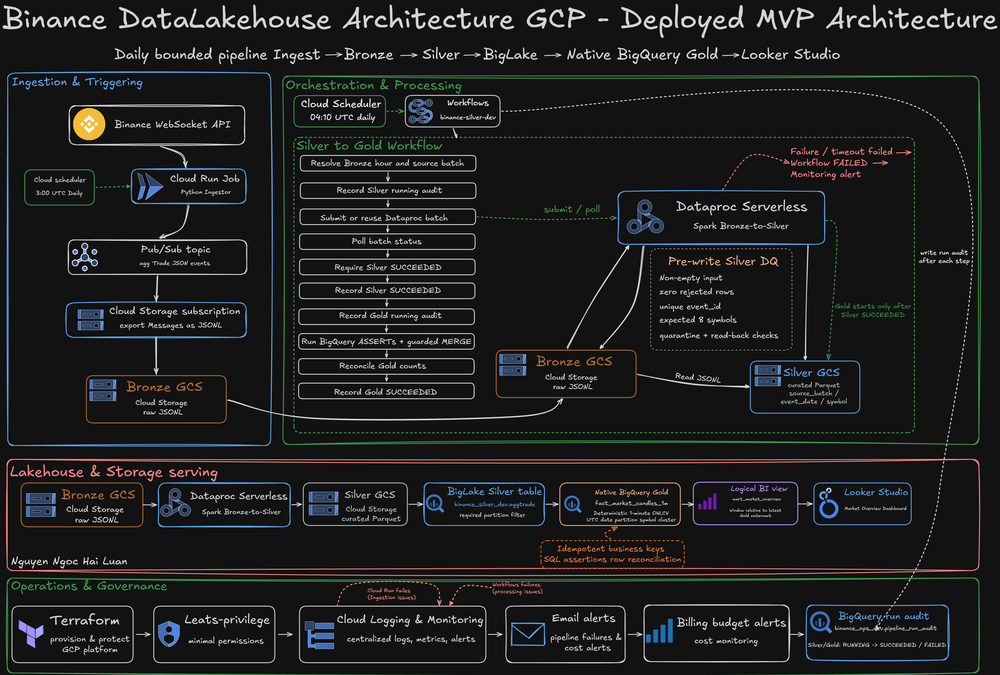
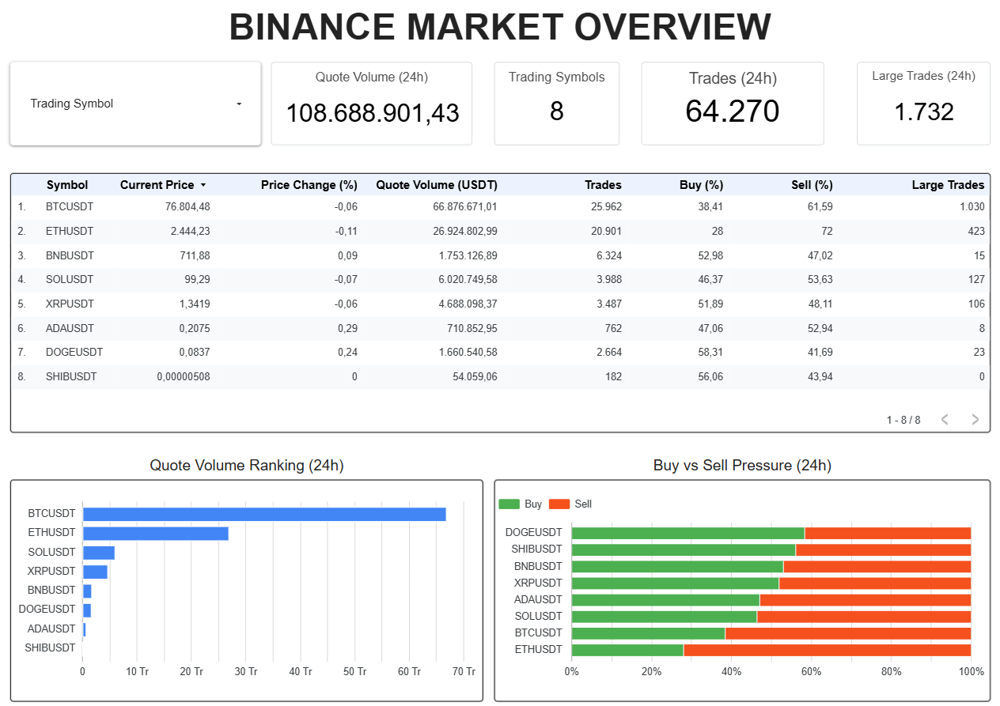
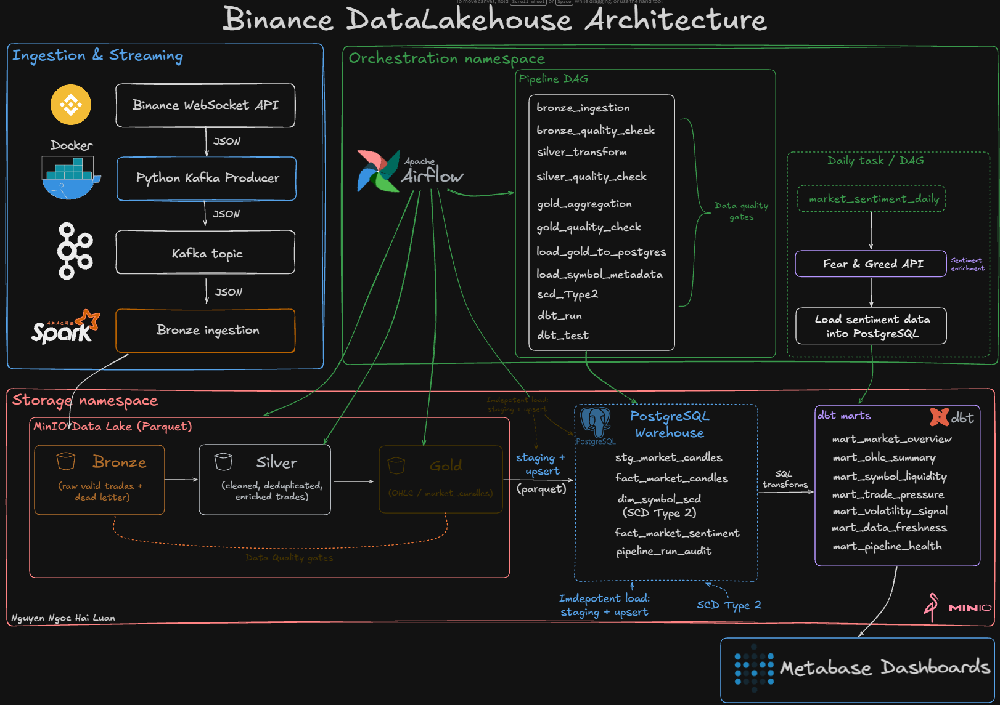
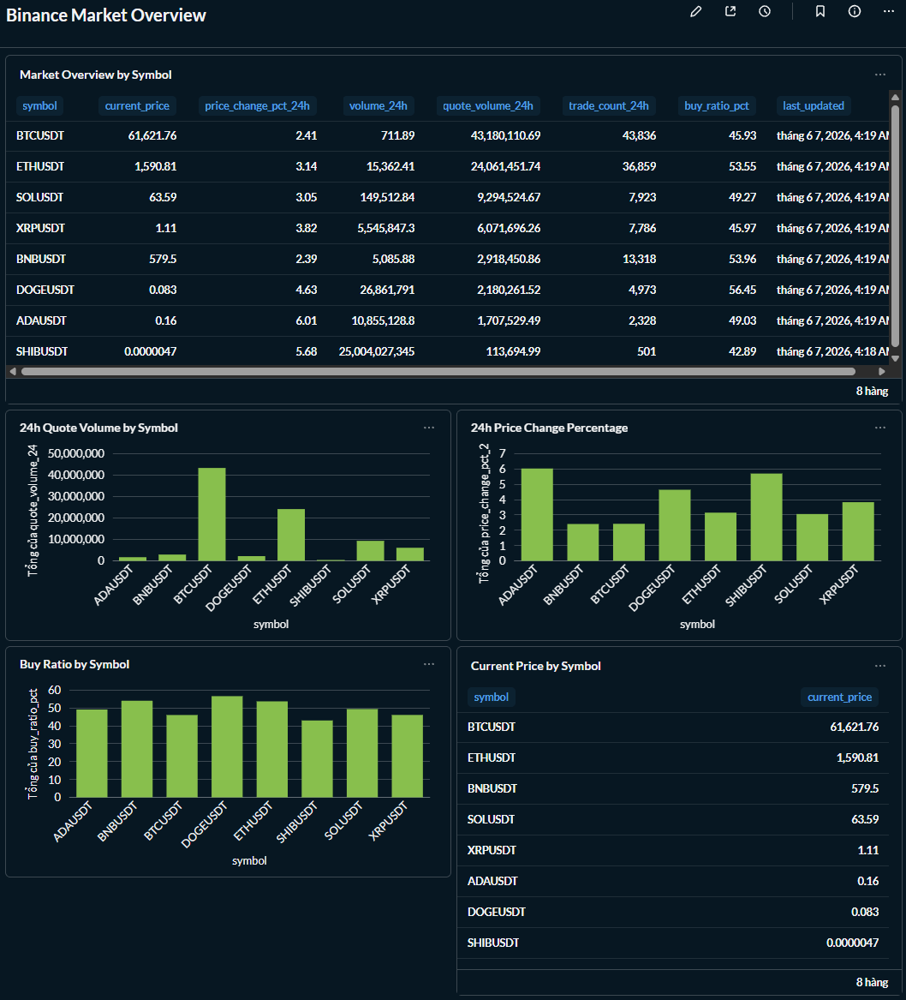
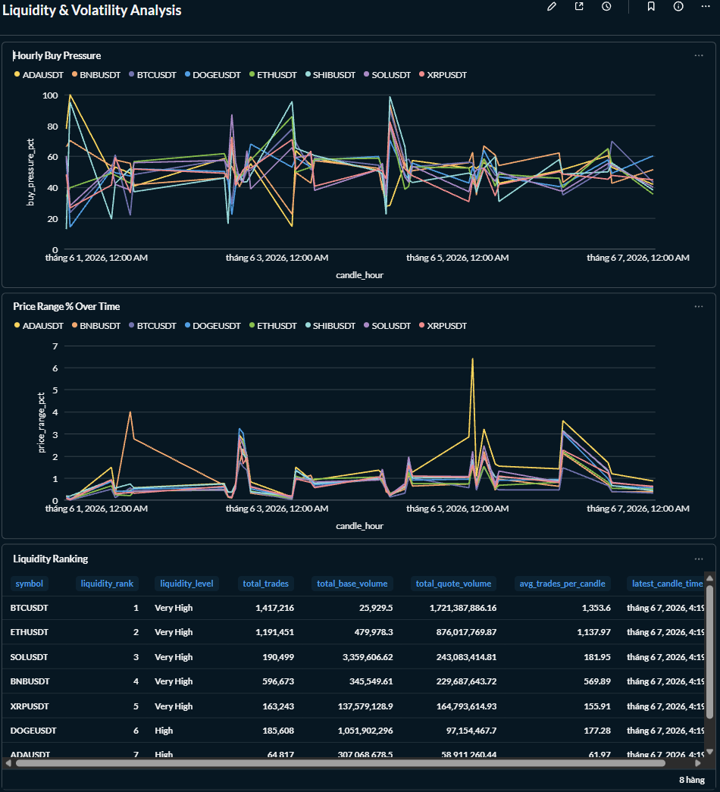
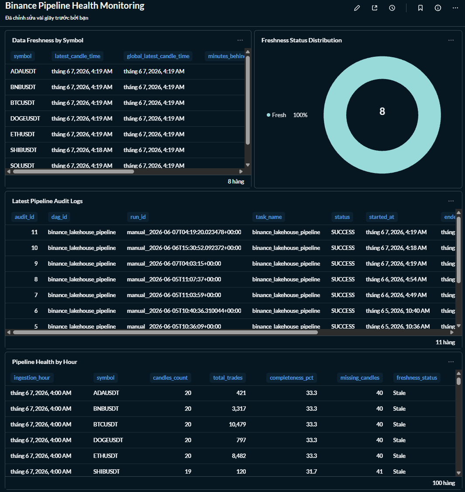
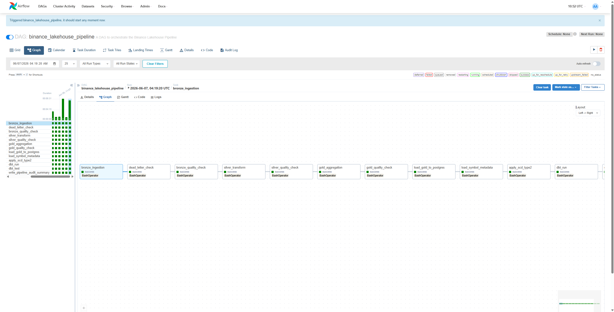
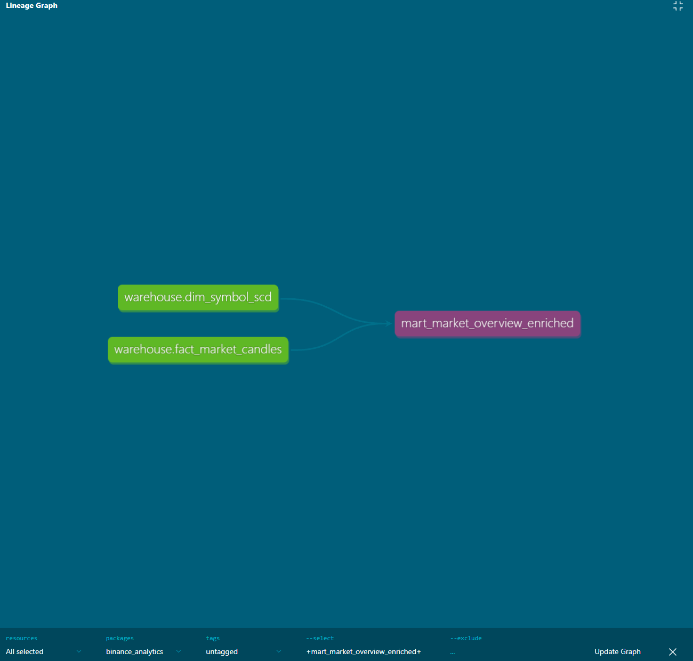

# Binance Data Lakehouse

**Local Analytics Platform & Deployed GCP MVP**

[](https://github.com/LuanHai23/Binance_API_DataLakehouse/actions/workflows/CI.yml)

An end-to-end Data Engineering project that transforms Binance market trades into validated datasets, one-minute OHLC candles, analytical marts, and dashboards.

The project began as a Docker-based local platform and was extended to a managed Google Cloud implementation. The repository preserves both profiles to demonstrate ingestion, distributed processing, warehouse modeling, orchestration, infrastructure as code, and operational controls.

**GCP MVP status: deployed, runtime-accepted, and merged into `main`.** The accepted scope includes Bronze, Silver, BigLake access, native BigQuery Gold, a BI mart, a dashboard, data-quality gates, run history, alerts, and repository CI.

Acceptance evidence records dated development milestones. It does not represent a live service-health check.

## Deployment Profiles

| Component | Local analytics platform | Deployed GCP MVP |
| --- | --- | --- |
| Source | Binance public WebSocket trades | Binance public WebSocket aggTrade events |
| Ingestion | Python producer and Kafka | Cloud Run Job and Pub/Sub |
| Bronze storage | MinIO Parquet | Cloud Storage JSONL |
| Silver processing | Containerized PySpark | Dataproc Serverless PySpark |
| Silver access | MinIO Parquet | Cloud Storage Parquet and BigLake |
| Gold and serving | Spark, PostgreSQL, and dbt | Native BigQuery SQL and a BI view |
| Orchestration | Apache Airflow | Workflows and Cloud Scheduler |
| Visualization | Metabase | Looker Studio |
| Infrastructure | Docker Compose | Terraform and Cloud Build for the producer image |
| Execution model | Continuous ingestion with micro-batch processing | One bounded ingestion window and scheduled processing per day |

The profiles share the Bronze/Silver/Gold design, while their implementations and analytics scope differ. Local dbt models run against PostgreSQL; cloud Gold and its serving view use BigQuery SQL managed through Terraform and Workflows.

## Data Products

| Output | Local | GCP |
| --- | --- | --- |
| One-minute OHLC candles | PostgreSQL fact table | Native BigQuery fact table |
| Market overview | dbt marts and Metabase | BigQuery mart and Looker Studio |
| Liquidity, trade pressure, and volatility | Dedicated dbt marts and dashboards | Quote-volume ranking and buy/sell pressure in the overview dashboard |
| Pipeline visibility | Airflow, warehouse audit logs, and freshness marts | Cloud Logging, Monitoring alerts, and Silver/Gold audit history |
| Symbol metadata history | SCD Type 2 dimension | Outside the accepted cloud scope |

## Deployed GCP MVP

### Architecture

[](docs/gcp-mvp/images/binance-gcp-lakehouse-architecture.png)

The data path is `Binance WebSocket → Cloud Run Job → Pub/Sub → Bronze GCS → Dataproc Serverless → Silver Parquet / BigLake → BigQuery Gold → BI mart → Looker Studio`.

| Stage | Responsibility |
| --- | --- |
| Ingestion | Validate event contracts and publish aggTrade events through an injectable publisher interface |
| Bronze | Preserve raw events as JSONL in UTC-hour storage prefixes |
| Silver | Validate, deduplicate, normalize, partition, and publish cleaned Parquet datasets |
| BigLake | Expose Silver through a partition-filtered external table |
| Gold | Reconstruct one-minute candles and persist them with a guarded, deterministic `MERGE` |
| Serving | Expose `mart_market_overview` as a protected BigQuery logical view |
| Operations | Coordinate stages with Workflows, record audit history, and report failures through Monitoring |

### Schedule and Data Coverage

| Stage | UTC | Vietnam time | Behavior |
| --- | --- | --- | --- |
| Ingestion | 03:00 daily | 10:00 daily | Collect a bounded 55-minute window |
| Silver and Gold | 04:10 daily | 11:10 daily | Process the preceding source hour and refresh Gold |

This development schedule limits compute usage. It captures a daily sample of market activity rather than continuous 24-hour coverage.

The market overview uses `(W - 24 hours, W]`, where `W` is the latest stored Gold candle start. Missing candles are not filled. Prices and volume metrics describe collected trades; the latest stored price is not a real-time quote.

### Engineering Controls

- **Infrastructure:** Terraform manages service APIs, workload identities, storage, networking, Workflows, Scheduler, BigQuery resources, and alert policies.
- **Silver quality:** Pre-publish gates reject empty valid output, rejected records, duplicate event IDs, or an unexpected symbol set. Rejected records remain available in quarantine.
- **Gold correctness:** Eligibility checks, deterministic candle construction, business-key validation, and reconciliation guard warehouse writes.
- **Reruns:** Deterministic Dataproc batch identifiers support reuse of a successful batch; guarded Gold writes preserve candle keys on rerun.
- **Run history:** BigQuery records Silver and Gold stage transitions, execution identifiers, resource references, available row counts, and errors.
- **Access:** Dedicated service accounts, scoped IAM grants, partition filters, and table deletion protection limit access and accidental changes.
- **Cost visibility:** Daily execution, bounded ingestion, query-byte limits, and a VND 500,000 monthly budget alert support development cost control. The budget is alert-only.

### Runtime Acceptance

These are separate acceptance runs. Their counts describe different source batches.

| Milestone | Date | Source trades | Accepted output | Evidence |
| --- | --- | ---: | --- | --- |
| First unattended Bronze/Silver cycle | 2026-09-09 | 50,917 | 50,917 Silver rows across 8 symbols; no rejected, duplicate, or quarantine rows | [Initial acceptance](docs/gcp-mvp/ACCEPTANCE_EVIDENCE.md) |
| First unattended Gold cycle | 2026-09-11 | 64,270 | 440 candles across 8 symbols; zero duplicate business keys | [Gold acceptance](docs/gcp-gold/ACCEPTANCE_EVIDENCE.md) |
| Controlled rerun and audit acceptance | 2026-09-16 | 57,952 | 447 candles; reused successful Silver batch; 2 successful stage-audit rows | [Run history evidence](docs/gcp-mvp/RUN_AUDIT.md#accepted-runtime-evidence) |

The first cloud BI increment also passed mart reconciliation and an interactive trading-symbol filter test. See [BI acceptance](docs/gcp-gold/BI_ACCEPTANCE_EVIDENCE.md).

### Cloud Dashboard

[](docs/gcp-gold/BI_ACCEPTANCE_EVIDENCE.md)

The dashboard presents market totals, symbol-level prices, quote-volume ranking, buy/sell pressure, and a trading-symbol filter. The screenshot is a historical acceptance snapshot.

## Local Analytics Platform

The local profile demonstrates a broader analytics workflow using Kafka, PySpark, MinIO, PostgreSQL, dbt, Airflow, and Metabase.



Its data path is `Binance WebSocket → Kafka → Spark Bronze/Silver/Gold → MinIO → PostgreSQL staging and upsert → dbt marts → Metabase`.

### Local Engineering Features

- Preserve raw messages and Kafka metadata in Bronze, with invalid-record routing.
- Clean, deduplicate, and enrich trades in Silver.
- Aggregate one-minute OHLC, volume, trade counts, and buy/sell pressure in Gold.
- Load PostgreSQL through staging tables and `ON CONFLICT DO UPDATE`.
- Track symbol metadata with an SCD Type 2 dimension.
- Orchestrate processing, quality checks, warehouse loading, dbt, and audit logging through Airflow.
- Build 8 enabled dbt models for market overview, OHLC, liquidity, trade pressure, volatility, freshness, and pipeline health.
- Present 3 Metabase dashboards for market overview, liquidity/volatility, and pipeline health.

### Local Development Metrics

| Metric | Recorded development snapshot |
| --- | ---: |
| Kafka-retained trade events | 3.7M+ |
| PostgreSQL candle fact rows | 3,600+ |
| Enabled dbt models | 8 |
| Metabase dashboards | 3 |

The event and row totals are historical local-development observations retained from the [earlier README](https://github.com/LuanHai23/Binance_API_DataLakehouse/blob/f07f24c88534052407269e43467a22e8738e21a9/README.md#-project-metrics). They are not cloud totals, throughput benchmarks, or a fresh measurement.

<details>
<summary>Local dashboard and pipeline screenshots</summary>

### Market Overview



### Liquidity and Volatility



### Pipeline Health



### Airflow Execution



### dbt Lineage



</details>

## Getting Started

### Local Setup

Prerequisites: Git, Docker Engine or Docker Desktop, and Docker Compose. Python and dbt are required when running their commands outside the containers.

```bash
git clone https://github.com/LuanHai23/Binance_API_DataLakehouse.git
cd Binance_API_DataLakehouse
cp .env.example .env
```

Configure `.env` against [docker-compose.yml](docker-compose.yml), including PostgreSQL, MinIO, Kafka, and Metabase settings. Keep shared connection settings consistent with the Airflow and dbt configuration.

```bash
docker compose config --quiet
docker compose up -d postgres zookeeper kafka minio spark-master spark-worker-1 spark-worker-2
```

Before triggering the analytics pipeline, complete the one-time local bootstrap:

1. Create the `bronze`, `silver`, and `gold` buckets in MinIO.
2. Create `warehouse_db` and initialize the warehouse tables using the DDL files under [scripts/init_db](scripts/init_db/).
3. Create the PostgreSQL metadata database configured for Metabase.
4. Confirm that PostgreSQL is healthy, then initialize Airflow and start the application services:

```bash
docker compose run --rm airflow-init
docker compose up -d airflow-webserver airflow-scheduler binance_producer metabase
```

Enable and trigger `binance_lakehouse_pipeline` in Airflow after the producer has collected data. The optional `market_sentiment_daily` DAG ingests sentiment data; its experimental dbt join model is disabled.

| Service | Local address |
| --- | --- |
| Airflow | http://localhost:8081 |
| MinIO console | http://localhost:9001 |
| Metabase | http://localhost:3000 |
| Spark master UI | http://localhost:8080 |
| PostgreSQL from host | localhost:5433 |

The local profile includes environment-specific bootstrap steps and demonstration configuration. Inspect [Docker Compose](docker-compose.yml), the [main DAG](dags/binance_lakehouse_pipeline_dag.py), and [dbt configuration](binance_analytics/) when adapting it to a new machine.

### GCP Operations

Start with the [operations runbook](docs/gcp-mvp/OPERATIONS_RUNBOOK.md), then use the [Gold data contract](docs/gcp-gold/DATA_CONTRACT.md) and [Silver/Gold run-history guide](docs/gcp-mvp/RUN_AUDIT.md) for the extended pipeline.

Cloud deployment uses project-specific Terraform backend, IAM, billing, and runtime settings under [infra/terraform](infra/terraform/). Docker Compose starts the local profile; it does not deploy the cloud profile.

## Testing and CI

[GitHub Actions](.github/workflows/CI.yml) runs three validation jobs on pushes and pull requests:

| Job | Scope |
| --- | --- |
| Python and YAML | Python syntax, producer unit tests, tracked YAML, and rendered GCP Workflow definitions |
| Terraform | Formatting, backend-disabled initialization, and configuration validation |
| dbt | Locked dependency installation and full project parsing without a warehouse connection |

Verified repository evidence:

- **84 Python unit tests passed** and **11 tracked YAML files validated** in the [current-main CI run](https://github.com/LuanHai23/Binance_API_DataLakehouse/actions/runs/38062527131) for commit `f07f24c`.
- **8 enabled dbt models and 37 test nodes** were recorded during merge acceptance. Parsing test nodes does not execute those tests against data.
- All three jobs passed in both the [post-merge run](https://github.com/LuanHai23/Binance_API_DataLakehouse/actions/runs/35369512931) and the current-main run above.
- [PR #1](https://github.com/LuanHai23/Binance_API_DataLakehouse/pull/1) contains the finalized migration scope and runtime acceptance evidence.

CI uses read-only repository permissions and no GCP credentials. Infrastructure deployment and cloud runtime acceptance are separate from these checks.

## Repository Guide

| Path | Responsibility |
| --- | --- |
| [kafka_producer/](kafka_producer/) | Binance ingestion, event contracts, publisher adapters, and runtime controls |
| [scripts/Medallion/](scripts/Medallion/) | Local Spark layers, cloud Silver batch, and warehouse loaders |
| [scripts/data_quality_check/](scripts/data_quality_check/) | Local quality-check scripts |
| [scripts/init_db/](scripts/init_db/) | Local warehouse DDL, SCD logic, and upsert SQL |
| [dags/](dags/) | Local Airflow orchestration |
| [binance_analytics/](binance_analytics/) | Local PostgreSQL dbt models, tests, and configuration |
| [infra/terraform/](infra/terraform/) | GCP infrastructure, IAM, scheduling, monitoring, and Workflows |
| [sql/gcp_gold/](sql/gcp_gold/) | Cloud candle construction and BI view SQL |
| [sql/gcp_ops/](sql/gcp_ops/) | Cloud stage-audit SQL |
| [cloudbuild.producer.yaml](cloudbuild.producer.yaml) | Producer image build configuration |
| [tests/](tests/) | Python unit tests |
| [.github/workflows/CI.yml](.github/workflows/CI.yml) | Repository validation workflow |

## Documentation and Evidence

| Document | Scope |
| --- | --- |
| [Initial GCP acceptance](docs/gcp-mvp/ACCEPTANCE_EVIDENCE.md) | First unattended Bronze/Silver/BigLake milestone |
| [Operations runbook](docs/gcp-mvp/OPERATIONS_RUNBOOK.md) | Initial deployment operations and Silver DQ controls |
| [Cloud Gold contract](docs/gcp-gold/DATA_CONTRACT.md) | Candle schema, grain, and loading rules |
| [Cloud Gold acceptance](docs/gcp-gold/ACCEPTANCE_EVIDENCE.md) | Automated Gold execution, reconciliation, and rerun behavior |
| [Cloud BI acceptance](docs/gcp-gold/BI_ACCEPTANCE_EVIDENCE.md) | Dashboard validation and rolling-window correction |
| [Run audit guide](docs/gcp-mvp/RUN_AUDIT.md) | Silver/Gold stage history, failure semantics, and final acceptance |
| [Merged migration PR](https://github.com/LuanHai23/Binance_API_DataLakehouse/pull/1) | Consolidated implementation and merge evidence |

The documents preserve successive milestones. Statements about future Gold or BI work in the initial Bronze/Silver documents describe that earlier scope; later Gold, BI, and audit acceptance extend it.

## Known Limitations and Next Steps

| Area | Current boundary | Follow-up |
| --- | --- | --- |
| Cloud coverage | One bounded ingestion window per day | Evaluate greater coverage against compute and query cost |
| Recovery | Controlled historical backfill is not implemented | Add explicit range selection and tested replay controls |
| Audit history | Best-effort stage writes; forced cancellation can leave `RUNNING` rows | Add stale-run detection and audit completeness checks |
| Local portability | Manual database/bucket bootstrap and environment-specific configuration | Automate initialization and document a clean-machine smoke test |
| Event governance | Application-level contracts; no Kafka schema registry | Evaluate versioned schema compatibility controls |
| Delivery | CI validates source; cloud deployment remains separately controlled | Add reviewed promotion and rollback automation |
| Dependencies | dbt deprecation and package-update follow-ups remain | Validate compatibility before changing pinned dependencies |

## Author

**Nguyễn Ngọc Hải Luân** — Data Science graduate pursuing Data Engineer Intern/Fresher opportunities.

[GitHub](https://github.com/LuanHai23) · [Email](mailto:nguyenngochailuan16112003@gmail.com)
